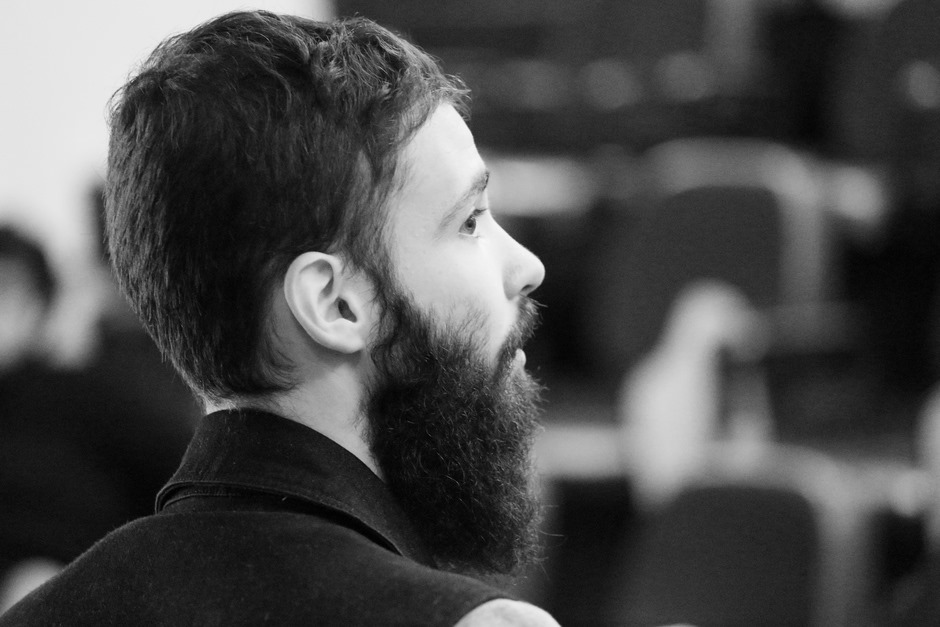

**Bachelor of Science in Biology**, 2014-2018, Federal University of Paraná (UFPR), Curitiba/PR, Brazil

**Masters in Zoology**, 2019-2021, UFPR, Curitiba/PR, Brazil

**MBA in School Management**, 2020–2022, University of São Paulo (USP), São Paulo/SP, Brazil

**PhD in Zoology**, 2021–2025, UFPR, Curitiba, PR, Brazil

-   Visiting Scholar at the University of North Carolina at Chapel Hill (U.S.) (2023)

{fig-align="center" width="373"}
