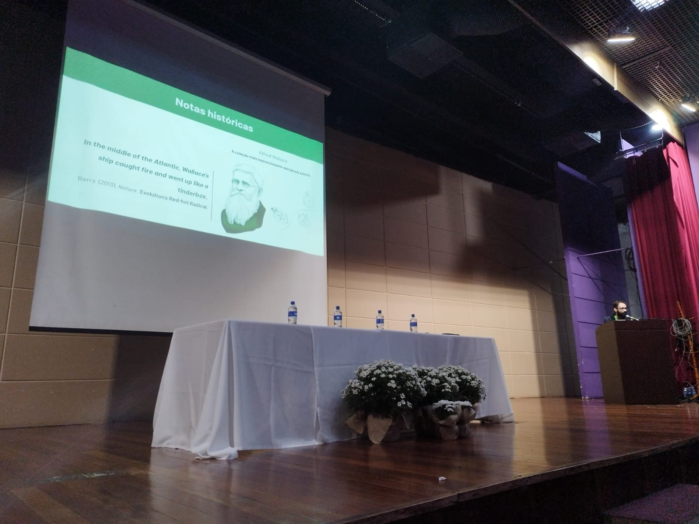

## Organization

**Brazilian Congress of Evolutionary Biology (2024 & 2026) - see [here](https://www.sbbevol.org/congressos)**

-   Coordinator of the Students Committee

**I Paranaense Symposium of Zoology (2020)**

-   Coordinator of the Audiovisual Committee

**TEDxUFPR (2019 & 2020) - see [here](https://www.youtube.com/playlist?list=PLsRNoUx8w3rMUqwgr45b0WxK3mO3VpUdh) and [here](youtube.com/playlist?list=PLsRNoUx8w3rPhS71cikAVgvg7Ke_LNRxz&si=tKOu6h3PkH4qk8rW)**

-   Licensed organizer, lead-coordinator

## Presentations

**Evolution Meeting (2026, US)**

-   Mitochondrial genome evolution: the influence of partitioning, calibration, and gene heterogeneity on Pleurodontan substitution rates \| *Oral* & *Poster presentation*

**II Brazilian Congress of Evolutionary Biology (2026, Brazil)**

-   Mitochondrial genome evolution: the influence of partitioning, calibration, and gene heterogeneity on Pleurodontan substitution rates \| *Poster presentation*

**XXXVI Brazilian Congress of Zoology (2026, Brazil)**

-   Genômica evolutiva e biogeografia do grupo *Tropidurus spinulosus* (Squamata, Tropiduridae) (Squamata, Tropiduridae) \| *Poster presentation*
-   Análise de dados moleculares com Pynnotate: do genbank à filogenia em minutos \| *Workshop*

**I Brazilian Congress of Evolutionary Biology (2024, Brazil)**

-   Ancient demographic history explains mitochondrial genome capture and mitonuclear discordance among South American collared *Tropidurus* lizards \| *Poster presentation*

**SMBE 2023 (2023, Italy)**

-   Machine learning in species delimitation \| *Poster presentation*

**XXXIV Brazilian Congress of Zoology (2022, Brazil)**

-   Filogeografia de *Tropidurus xanthochilus* (Squamata, Tropiduridae) \| *Poster presentation*

