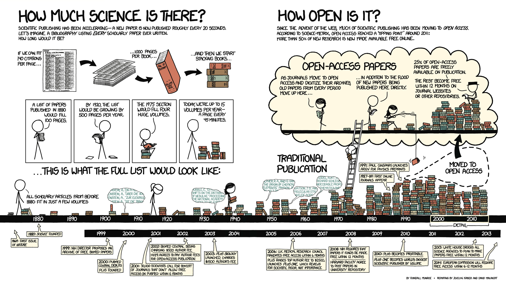

In recent years, I’ve also started exploring the world of **Open Science**! It’s been a really rewarding space to work in, especially when it comes to making research more transparent, accessible, and collaborative. Below are some of the recent experiences I’ve had in this area.

### [**Brazilian Reproducibility Network**](https://www.reprodutibilidade.org/)

-   Evolutionary Biology Ambassador, 2024-2025

### **Society for Open, Reliable, and Transparent Ecology and Evolutionary biology ([SORTEE](https://sortee.org/))**

-   Editor and member of the EcoEvoRxiv Committee, 2025-present
-   Founding member of the SORTEE Brazilian Chapter

### [**PCI Evolutionary Biology**](https://evolbiol.peercommunityin.org/)

-   Data Editor

