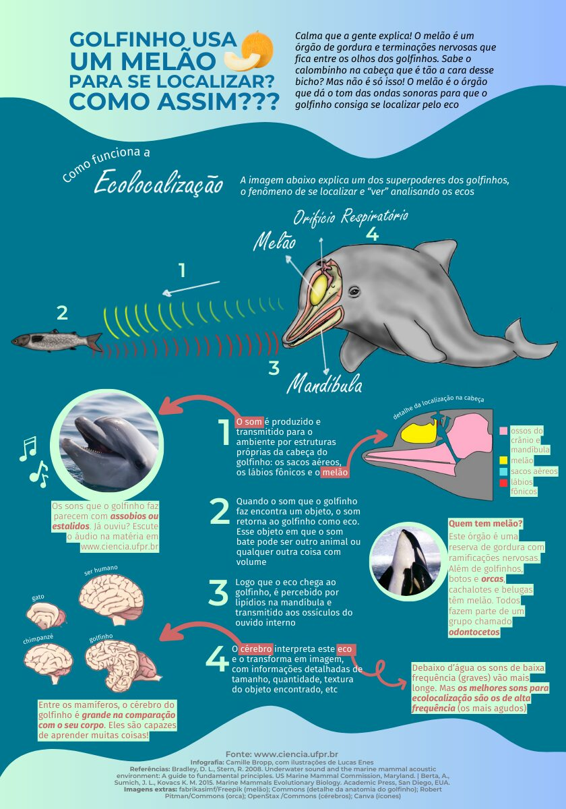

## YouTube videos

Between 2020 and 2021, I had the privilege of contributing to one of Brazil’s largest science communication channels. During that time, I worked on script writing and scientific review for **Nerdologia**, helping transform complex scientific topics into engaging and accessible content for broad audiences. Below are some of the videos I had the opportunity to contribute to.

**Kraken**

<iframe width="480" height="270" src="https://www.youtube.com/embed/In33klT7t6Q" title="Kraken" frameborder="0" allow="accelerometer; autoplay; clipboard-write; encrypted-media; gyroscope; picture-in-picture" allowfullscreen>

</iframe>

**The creatures from "A quiet place"**

<iframe width="480" height="270" src="https://www.youtube.com/embed/e12KSrSrs00" title="A quiet place" frameborder="0" allow="accelerometer; autoplay; clipboard-write; encrypted-media; gyroscope; picture-in-picture" allowfullscreen>

</iframe>

**Werewolves**

<iframe width="480" height="270" src="https://www.youtube.com/embed/upKBLGyOV0Q" title="Werewolves" frameborder="0" allow="accelerometer; autoplay; clipboard-write; encrypted-media; gyroscope; picture-in-picture" allowfullscreen>

</iframe>

## Texts

As a big fan of **Carl Sagan**, I’ve always loved writing about science for broader audiences. I started doing this more often during my undergraduate years, when I even created a small science communication blog to share ideas and make scientific topics more accessible and interesting. Since then, I’ve kept writing occasional outreach pieces, like the one featured below.

## TED

Since 2021, I’ve also had the opportunity to collaborate with **TED**. I work with scientific consulting and fact-checking for a variety of their productions, including video series, talks, podcast episodes, and other educational content. It’s been a great experience helping ensure scientific accuracy while making ideas clear, engaging, and accessible to broad audiences. Below are some examples of materials I had the chance to contribute to.

**The Magical, Mesmerizing Migration of Monarch Butterflies \| Jaime Rojo \| TED**

<iframe width="560" height="315" src="https://www.youtube.com/embed/PnBMdJ5KeHk?si=YSv_au6M_XKAeTB_" title="YouTube video player" frameborder="0" allow="accelerometer; autoplay; clipboard-write; encrypted-media; gyroscope; picture-in-picture; web-share" referrerpolicy="strict-origin-when-cross-origin" allowfullscreen>

</iframe>

**How Your Brain Alters Your Reality (W/ Anil Seth) \| How to Be a Better Human \| TED**

<iframe width="560" height="315" src="https://www.youtube.com/embed/n6VzKtEKs3o?si=XgSx5uunXrN1E5m1" title="YouTube video player" frameborder="0" allow="accelerometer; autoplay; clipboard-write; encrypted-media; gyroscope; picture-in-picture; web-share" referrerpolicy="strict-origin-when-cross-origin" allowfullscreen>

</iframe>
